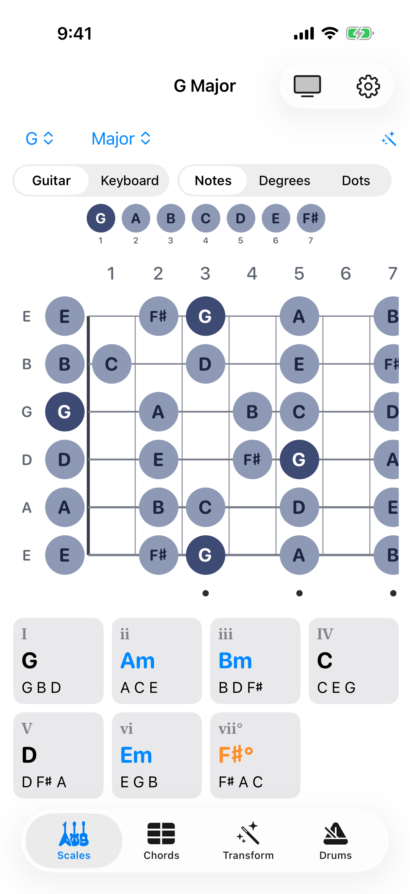
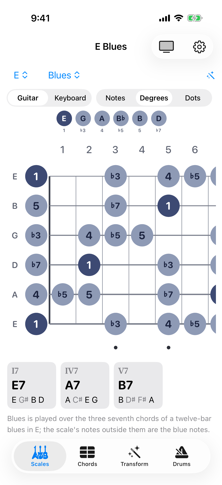
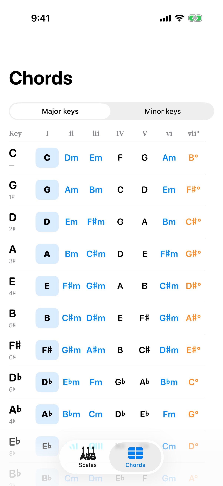

# Scales

Scales draws any musical scale across the guitar neck or a piano keyboard and puts it on
the TV, so a player can read the shape from across the room while practising.

<p align="center">
  
  
  
</p>

## What it does

- **Any scale, any key.** Pick a root and a scale; the notes appear on every string and
  fret, or on one or two piano octaves. Labels show note names, scale degrees, or nothing.
- **Chords of the scale.** The chords the scale makes sit under the board. Tap one and its
  notes are ringed on the board, the notes row and the TV while the rest of the scale stays
  in view.
- **Change one note.** Lower, raise, add or remove a note straight from the Scales screen.
  The chords update in place and show what each one was, which note is new, and which
  chords the scale lost. The Transform tab explains the same change as a lesson.
- **Your own scales.** Changed scales can be saved under a name and chosen later like any
  built-in one.
- **Chord tables.** The Chords tab lists the chords of every major and minor key.
- **Drum trainer.** A groove written on the drum staff with a ball that bounces from count
  to count, for reading and playing along.
- **TV output.** Start AirPlay screen mirroring from Control Center and the app replaces
  the mirrored phone with its own full-screen board (Apple TV, Roku, AirPlay smart TVs).
  The AirPlay button in the app casts the board as video instead. A full-screen board on
  the phone or iPad covers the case where no TV is around.
- **iPhone, iPad and Mac.** One codebase; the Mac version is built with Mac Catalyst and
  handed out as a download.

## Requirements

- iOS or iPadOS 26 or later; macOS for the Catalyst build.
- Xcode 26 or later with Swift 6.
- [xcodegen](https://github.com/yonaskolb/XcodeGen) to generate the Xcode project.

## Building

The Xcode project is generated from `project.yml`; edit the yml rather than the
`.xcodeproj`, which is git-ignored.

```sh
make build                                  # iPhone simulator build
make run                                    # build, then open it in the simulator
make test                                   # unit and UI tests
make test SIM="iPad Pro 13-inch (M5)"       # the same on an iPad
make run-device DEVICE="<your iPhone>"      # install on a plugged-in phone
make lint                                   # swift-format, strict
make format
```

Mac:

```sh
make mac            # Catalyst build, signed for this Mac only
make run-mac
make install-mac    # Release copy into /Applications/Scales.app
```

`scripts/build_mac_dmg.sh` and `scripts/notarize_mac_dmg.sh` produce a notarised disk
image, and `scripts/deploy_to_store.sh` uploads to App Store Connect; both need the
owner's certificates.

## Layout

| Folder | Holds |
| --- | --- |
| `Scales/Music` | Pure theory with no UI: note spelling, scale formulas, tunings, fret and key positions, chord stacking, scale recognition. |
| `Scales/Session` | The practice settings shared by the phone screen and the TV screen, and the saved-scale library. |
| `Scales/Views` | SwiftUI views: fretboard, keyboard, chord chips, edit menus, the Transform and Chords tabs, the TV scene. |
| `Scales/Cast` | AirPlay video casting: the board rendered to a short H.264 clip and served to the TV. |
| `Scales/Drums` | The drum groove player and staff renderer. |
| `ScalesTests`, `ScalesUITests` | Unit tests of the theory and session code; UI tests that drive each tab and take the store screenshots. |

## Notes on the TV path

An app cannot start screen mirroring by itself; the player starts it from Control Center.
Once mirroring runs, iOS offers the foreground app a scene for the external display, and
Scales attaches its board to it. Capture tools such as QuickTime never offer that scene.
The in-app AirPlay button takes a different route: the board is encoded once as a looping
video and streamed to the TV over the local network, which needs the Local Network
permission.

## License

Copyright © 2026 Alnour Alharin <alnour.ahmed@gmail.com>.

Scales is free software under the [GNU General Public License v3.0 or later](LICENSE).
You may use, study, change and redistribute it, provided any copy or derived work is
shared under the same license with its source available. See [COPYRIGHT.md](COPYRIGHT.md).
